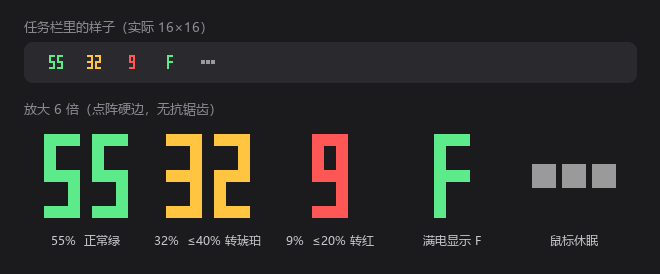

# ATK A9 Battery

把 ATK A9 Pro Max 的电量百分比直接画在 Windows 任务栏托盘图标上。原生 Win32 实现，29 KB 单文件，不需要 .NET / Python / 任何运行库，常驻内存约 2.5 MB。

> A tiny 29 KB native Windows tray app that shows your ATK / VXE mouse battery percentage right on the tray icon.



上图是同一套图标的五种状态：正常绿、≤40% 琥珀、≤20% 红、满电显 F、鼠标休眠三点。上半部分是任务栏里的实际大小（16×16），下半部分是放大 6 倍的点阵细节。

## 为什么写这个

ATK A9 Pro Max 的 8K nano 接收器（`VID_373B / PID_11DC`）用的是 **Nordic 54 系协议**（HID usage page `0xFF05`，命令 `0x72`），而网上常见的鼠标电量工具（HaloBattery、GearPower、0x44oge-ATK 等）读的都是老款 ATK/VXE 的 **Compx 协议**（`0xFF02` + 17 字节 `0x04` 命令）。这些接收器根本没有暴露 `0xFF02` 接口，所以那些工具会一直显示“未检测到设备”。

这个程序直接对接 `0xFF05` 接口，能读到 1% 粒度的真实电量和电芯电压。

## 特性

- **图标即数字**：托盘图标就是电量本身（如 `55`），3×7 点阵像素字硬边绘制，按图标尺寸取整数倍放大，16px 下两位数能占满 14×14
- **1% 粒度**：鼠标电量计原值，不做 10% 分档
- **悬停看细节**：百分比 + 电芯电压 + 最后更新时间
- **颜色分级**：亮绿 = 正常，琥珀 = ≤40%，红 = ≤20%，低于 20% 弹一次气泡提醒
- **满电显示 F**：100% 时图标画一个占满格子的 `F`，悬停提示里仍是 100%
- **休眠区分**：接收器在但鼠标休眠时，图标变成三个灰点，悬停显示“上次 xx%”，不会误报成 0%
- **热插拔**：拔插接收器自动恢复，不需要重启程序
- **刷新间隔可选**：30 秒 / 60 秒 / 5 分钟 / 15 分钟，左键点击图标可立即刷新
- **开机自启**：首次运行自动写入 `HKCU\...\CurrentVersion\Run`，可在菜单里关闭
- **单实例**：重复启动不会出现两个图标
- **有线也能读**：插数据线充电时自动切到直连链路，悬停提示标注“（有线）”，不会再误显示成休眠
- **插拔自动刷新**：插拔数据线或接收器后 1.2 秒自动更新一次，不用等轮询周期
- **省电**：每次刷新只发一个 64 字节 HID 报文，空闲 CPU 占用为 0

## 系统要求

- Windows 10 / 11（x64）
- 2.4G 接收器在线，或数据线直连（两种模式都能读，插线充电时显示的是有线链路的真实电量）

## 安装

### 方式一：下载预编译版本

从 [Releases](https://github.com/Lkig/ATK-A9-Battery/releases) 下载 `ATKA9Battery.exe`，放到任意固定目录（例如 `C:\Tools\ATKA9Battery\`）双击运行即可。首次运行会自动开启开机自启。

### 方式二：自行编译

需要 MinGW-w64（或任何能链接 Win32 导入库的 gcc）：

```bat
gcc -O2 -s -municode -mwindows -o ATKA9Battery.exe src\atkbat.c ^
    -lhid -lsetupapi -lshell32 -luser32 -lgdi32 -ladvapi32
```

也可以直接双击 `build.bat`。

## 使用

| 操作 | 效果 |
| --- | --- |
| 左键单击图标 | 立即刷新 |
| 悬停 | 显示电量、电压、更新时间 |
| 右键 | 立即刷新 / 刷新间隔 / 开机自启 / 退出 |

**图标被收进 `^` 折叠区？** Windows 11 默认把新图标放进折叠区。从 `^` 里把它拖到任务栏上即可常驻，这是系统设置，只能手动拖一次。

命令行自检（在 cmd 里运行，能看到输出）：

```bat
ATKA9Battery.exe --once
:: 32% (3766 mV)    /    asleep    /    no device
```

## 资源占用（实测，作者机器）

| 项目 | 数值 |
| --- | --- |
| 可执行文件 | 29 KB |
| 私有内存 | 2.5 MB |
| 工作集 | 12.4 MB（大部分是 user32/gdi32 共享页，会被系统回收） |
| 线程 | 4 |
| 空闲 CPU | ≈ 0 |

作为对比，同样逻辑的 Python + hidapi 脚本私有内存约 14 MB、工作集 23 MB；pystray + Pillow 或 PyInstaller 打包版本在 30–50 MB。常驻托盘场景下原生的优势就在这里。

## 协议说明

接收器暴露多个 HID 集合（`0001` 键盘 / `000C` 消费类 / `FFB1` / `FFB3` / `FF05`），电量走 `FF05`：

```
usage page : 0xFF05
usage      : 0x0001
报告长度   : 64 字节（Input/Output 均为 64，无报告 ID 前缀以外的填充）
请求       : 08 7D 72 02 00 01 07 01
应答判定   : in[1] == 0x72 && in[5] == 0x07
   in[2] == 0x00 → in[7] = 百分比(0-100)，in[8] | in[9]<<8 = 电芯电压 mV
   in[2] != 0x00 → 鼠标休眠，设备未应答
```

**`out[5]` 是链路选择，这点很关键**：

| out[5] | 含义 | 场景 |
| --- | --- | --- |
| `0x01` | 鼠标挂在 2.4G 接收器后面 | 无线使用 |
| `0x00` | 数据线直连鼠标本体 | 插线充电 / 有线使用 |

插上数据线后，鼠标会以另一个 PID 枚举出自己的一套 HID 接口（例如 `PID_1264`，产品名 `ATK A9 PRO MAX 2.0 NK`），此时接收器仍然在，但后面已经没有设备了 —— 对接收器发 `out[5]=0x01` 会**超时无响应**，发 `out[5]=0x00` 则返回 `handler=0` 但 **0% / 0 mV 的占位数据**。所以程序对两种链路都试，并用「`handler==0` 且（电压 ≥2000 mV 或 百分比 >0）」排除占位应答，否则充电时就会误判成休眠或 0%。

同一套报文在 Linux（hidraw）和 macOS（IOHID）上同样成立，只有打开设备的方式不同。

## 图标是怎么画的

没有用 GDI 字体渲染，而是内置一套 3×7 的点阵字模（`GLYPH[11][7]`），按图标尺寸算整数放大倍数逐格填充。这样在只有 16×16 的托盘尺寸里，笔画永远是 2px 的硬边方块，不会像抗锯齿字体那样糊掉；也不会因为系统字体版本不同而变形。

两位数字占 7 个单元宽（3+1+3），16px 图标取 2 倍放大正好 14×14，四周各留 1px。可以通过 `--icon` 导出图标检查效果：

```bat
ATKA9Battery.exe --icon out.bmp --s16 --text 55
ATKA9Battery.exe --icon dots.bmp --s16 --dots
```


## 适配其他机型

程序**只按厂商 ID + 厂商自定义 HID 集合**匹配，不限定 PID：

```c
#define VID_MATCH        0x373B
#define USAGE_PAGE_MATCH 0xFF05
#define USAGE_MATCH      0x0001
```

原因是同一个鼠标在不同连接方式下会以不同 PID 枚举（接收器 `0x11DC`、有线本体 `0x1264`），不同批次的配对通道也会让接收器 PID 变化。只要设备还是 Nordic 54 系（`0xFF05` + `0x72`），换上就能用，不用改任何 ID。

想确认真机枚举出了什么，可以跑：

```powershell
Get-PnpDevice -PresentOnly | Where-Object { $_.InstanceId -match 'VID_373B' } |
  Select-Object -ExpandProperty InstanceId
```

输出里出现两个 PID 是正常的：一个是接收器，一个是有线连接时的鼠标本体。

如果是老款 Compx 方案（`0xFF02` + 17 字节 `0x04` 命令），本程序的读取逻辑不适用。

## 已知限制

- 蓝牙连接模式读不到电量（协议只暴露在 2.4G 与有线链路上）
- 与 ATK 官方网页驱动 / ATK HUB 同时打开时，可能被其独占 HID 集合，表现为“未检测到接收器”
- 菜单与提示文案为中文硬编码，改语言需改源码；点阵字形只覆盖 `0-9` 和 `F`
- 仅 64 位 Windows

## 卸载

1. 右键托盘图标 → 退出
2. 删除程序所在目录
3. 删除注册表项 `HKCU\Software\ATKA9Battery`；若“开机自启”仍开着，再删除
   `HKCU\Software\Microsoft\Windows\CurrentVersion\Run` 下的 `ATK A9 Battery`

## License

[MIT](LICENSE)
